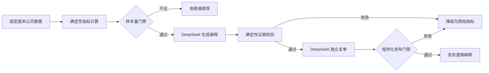

# Flight Ops AI Review

> 一个面向消费者的航司历史运行稳定性比较与可审计 AI 解释原型。

[](https://www.python.org/)
[](#测试与验证)
[](LICENSE)
[](data/README.md)

## 项目要解决什么问题

消费者选择航班时，除了价格和服务，也会关心航班是否容易取消、是否准点，以及发生延误后通常要等多久。本项目让用户在相同始发机场、目的地和日期范围内，基于历史数据比较候选航司的运行稳定性。

长期愿景是支持更多出发地和更新的数据。当前 MVP 只使用 `nycflights13 1.0.2` 的公开数据，覆盖 2013 年从 EWR、JFK、LGA 出发的 336,776 条航班记录，因此它是产品与风控方案验证，不是实时购票推荐系统。

## 已实现能力

- 从 CRAN 固定版本下载数据，校验官方压缩包、字段、行数和转换后文件哈希。
- 在相同航线与日期范围内计算计划航班量、取消率、到达延误率、到达准点率、平均延误时长和样本量。
- 用最低有效样本门禁阻止证据不足时的强推荐。
- 让 DeepSeek 只基于结构化证据生成消费者解释，不让模型重新计算事实指标。
- 使用第二次独立 DeepSeek 调用做语义复审，再由确定性程序校验证据引用、范围、限制项和输出结构。
- 模型失败、复审不通过或程序校验失败时，降级为只展示已验证指标。
- 记录模型、Prompt/证据哈希、延迟、token 用量和校验状态，但不记录 API Key。
- 12 项自动化测试覆盖指标口径、样本拒绝、引用校验和失败降级。

## 为什么不是“让 AI 直接判断”

事实计算、语言解释和发布门禁承担不同职责：



确定性程序负责“数字是否正确”，生成模型负责“用户是否看得懂”，独立复审负责“语义是否越界”，最终程序门禁负责“能否发布”。这个 MVP 不需要 RAG 或 Agent：输入证据规模小且结构固定，引入检索或自主工具调用不会解决当前核心风险，反而会增加成本和不可控性。

## 已验证示例：JFK → LAX

示例范围为 2013 全年、JFK 至 LAX、相同指标口径。所有候选航司的有效到达样本均达到 MVP 的最低样本要求。

| 航司 | 计划航班 | 取消率 | 到达延误率 | 到达准点率 | 延误航班平均延误 |
|---|---:|---:|---:|---:|---:|
| American Airlines | 3,217 | 0.65% | 18.29% | 81.71% | 63.49 分钟 |
| JetBlue Airways | 1,688 | 0.30% | 23.61% | 76.39% | 51.74 分钟 |
| Delta Air Lines | 2,501 | 0.36% | 16.61% | 83.39% | 48.90 分钟 |
| United Air Lines | 2,059 | 0.83% | 21.16% | 78.84% | 56.62 分钟 |
| Virgin America | 1,797 | 0.78% | 17.82% | 82.18% | 65.86 分钟 |

这个示例不计算未经验证的综合分数，也不宣布绝对“最佳航司”。例如，JetBlue 的取消率较低，但到达延误率较高；Delta 在这个特定范围内的到达准点率较高、延误率较低，但这仍不能代表当前或其他航线表现。

可核对证据：

- [结构化指标](examples/jfk_lax_2013_carrier_comparison.json)
- [真实 DeepSeek 解释](examples/deepseek_live/final_review.json)
- [独立 AI 复审结果](examples/deepseek_live/ai_reviewer.json)
- [脱敏运行审计](examples/deepseek_live/run_audit.json)
- [完整 AI 产品案例](docs/product_case.md)

## 快速开始

以下命令适用于 Windows PowerShell 和 Python 3.13。

### 1. 创建环境并安装依赖

```powershell
python -m venv .venv
& ".\.venv\Scripts\python.exe" -m pip install -r "requirements.txt"
```

### 2. 获取并验证公开数据

```powershell
& ".\.venv\Scripts\python.exe" "src\fetch_data.py"
```

原始数据保存在被 Git 忽略的 `data/raw/`；版本、字段、行数和哈希写入 `data/manifest.json`。

### 3. 生成航司比较证据

```powershell
& ".\.venv\Scripts\python.exe" "src\compare_carriers.py" `
  --origin JFK `
  --dest LAX `
  --start-date 2013-01-01 `
  --end-date 2013-12-31 `
  --output "outputs\jfk_lax.json"
```

### 4. 不使用 API，先验证本地样例模式

```powershell
& ".\.venv\Scripts\python.exe" "src\run_deepseek_pipeline.py" `
  --mode sample `
  --output-dir "outputs\sample_check"
```

### 5. 可选：运行 DeepSeek 在线模式

复制 `.env.example` 为 `.env`，只在本地填写自己的密钥：

```text
DEEPSEEK_API_KEY=<your-key>
DEEPSEEK_BASE_URL=https://api.deepseek.com
DEEPSEEK_MODEL=deepseek-flash
```

`.env` 已被 Git 忽略。不要把真实密钥粘贴到 Issue、截图或提交记录中。

```powershell
& ".\.venv\Scripts\python.exe" "src\run_deepseek_pipeline.py" `
  --mode api `
  --evidence "outputs\jfk_lax.json" `
  --output-dir "outputs\deepseek_run"
```

成功时会输出 `[STATUS] approved`。若模型或任一门禁失败，程序输出安全降级结果并以非零状态退出。

## 测试与验证

```powershell
& ".\.venv\Scripts\python.exe" -m unittest discover -s tests -v
```

当前基线：`12 tests passed`。

也可以单独复核一份 AI 解释：

```powershell
& ".\.venv\Scripts\python.exe" "src\validate_ai_review.py" `
  --evidence "examples\jfk_lax_2013_carrier_comparison.json" `
  --review "examples\deepseek_live\final_review.json"
```

## 目录说明

```text
data/       数据来源、许可与可复现 manifest
docs/       指标合同和 AI 产品案例
examples/   结构化指标、AI解释、复审和审计样例
prompts/    生成模型与独立复审 Prompt
src/        取数、指标计算、DeepSeek 管线和确定性验证器
tests/      自动化测试
```

## 真实边界

- 数据只覆盖 2013 年从纽约三座机场出发的历史航班，不能代表当前、未来或全球航班表现。
- 取消使用 `dep_time` 为空作为代理定义；到达延误定义为 `arr_delay > 15` 分钟。
- 最低 30 个有效到达样本是 MVP 产品规则，不是统计显著性结论。
- 历史表现只表示特定范围内的关联，不能证明延误由航司自身造成。
- 项目不覆盖票价、服务、行李政策、航线便利性和航空安全，不能替代完整购票决策。
- 项目尚未经过真实用户访谈、业务验证或线上使用，不代表航空公司的生产系统。

## 贡献与来源说明

本项目受课程中的航班报告任务启发，但在独立目录中重新定义消费者问题、重新获取公开数据并实现代码，不复制课程代码、模板或讲义。

AI 协助了文档结构、代码草稿、Prompt 草稿、测试设计、审查和排错；程铭负责产品定位与范围取舍、密钥安全配置、此前数据与分析批次的实际运行和结果核对，并决定发布边界。本次 DeepSeek 集成、真实调用及发布前检查由 AI 助手在本地项目中代为执行并留下审计证据，尚待程铭独立复跑与讲解验收。代码通过自动测试与真实 DeepSeek 调用验证，但“AI 协助完成”不等于作者可脱离资料独立编写全部代码。

数据集 `nycflights13 1.0.2` 采用 CC0，详见 [数据说明](data/README.md)。项目代码与原创文档采用 [MIT License](LICENSE)。
